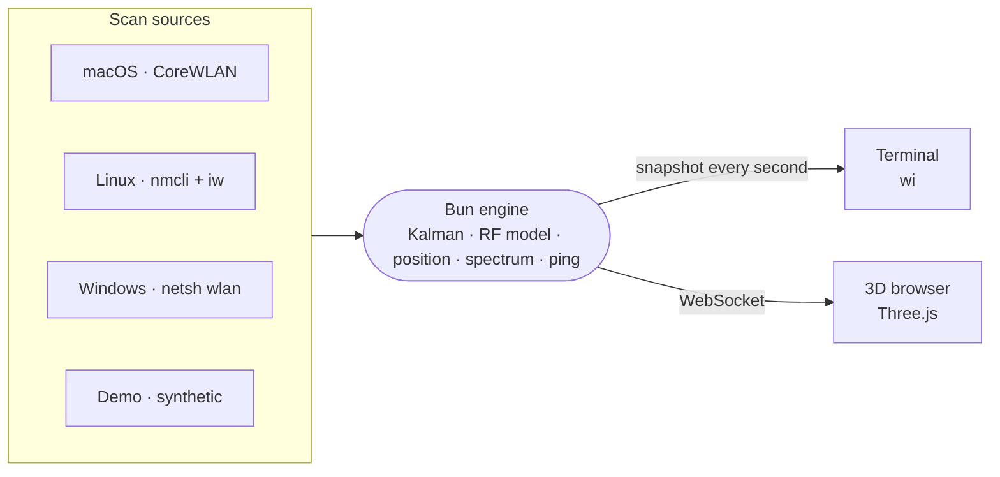

<div align="center">

<p></p>

<p>
  
  
  
  
  <a href="LICENSE"></a>
</p>

<br>

**WI//DIAG** shows the Wi-Fi around you. Every network becomes a point on the radar, at the distance estimated from its signal,<br>
with the channel it occupies, who interferes with whom, its security grade and the channel you should be using.<br>
All live, in two interfaces on top of the same Bun engine.

[Getting started](#getting-started) · [What it shows](#what-it-shows) · [Shortcuts](#shortcuts) · [How it works](#how-it-works) · [Platforms](#platforms) · [Privacy](#privacy)

</div>

<br>

<p align="center">
  
  <br>
  <sub><code>npm run web</code>: the RF space around the computer. The inspector is open on the printer that shares channel 6 with your router.</sub>
</p>

<p align="center">
  
  <br>
  <sub><code>npm run cli</code>: the same engine in the terminal. Sweep radar, link, networks, spectrum and events in full screen.</sub>
</p>

<br>

## What it shows

<table>
  <tr>
    <td width="33%"></td>
    <td width="33%"></td>
    <td width="33%"></td>
  </tr>
  <tr>
    <td valign="top"><b>RF field</b><br><sub>The predicted coverage of each network drawn on the floor, with contours from −50 to −80 dBm. Key <code>F</code>.</sub></td>
    <td valign="top"><b>Inspector</b><br><sub>Probable distance with an uncertainty range, security grade from A to F, vendor, channel and signal history.</sub></td>
    <td valign="top"><b>Cinema mode</b><br><sub>Only the RF space, no panels, to leave open on a screen. Key <code>H</code>.</sub></td>
  </tr>
</table>

| Layer | Data |
| --- | --- |
| Radio | Filtered RSSI (Kalman), peak, deviation, noise and SNR, channel, width, occupied spectrum range, DFS, PHY, Wi-Fi generation, theoretical PHY rate, beacon interval |
| Security | Protocol (from open network to WPA3/OWE) and grade from A to F |
| Identity | SSID, BSSID, vendor (OUI), randomized MAC, radios of the same AP grouped |
| Space | Estimated distance with uncertainty range, probable azimuth and height |
| Spectrum | Occupancy per channel, co-channel and partial interference, SIR, best channel per band |
| Link | Live RSSI and SNR, TX rate, MCS, IP/IPv6, gateway, router MAC and vendor, DNS |
| Network | Latency, jitter and loss to the gateway and to the internet (1.1.1.1), link diagnosis |
| Events | New networks, lost networks, roaming, channel changes, signal drops, latency spikes, internet down, router syslog |

## Getting started

```bash
npm install          # installs Bun (locally), Three.js and the rest
npm run cli          # terminal dashboard
npm run web          # 3D view in the browser (http://127.0.0.1:3333)
npm run demo         # dashboard with a synthetic environment, no hardware needed
```

> [!TIP]
> On macOS, run `npm run authorize` once and accept the Location request. Without that permission the system hides SSID and BSSID.

With Bun installed globally, `bun run cli` and `bun run web` also work, and `npm link` puts the `wi` command on your PATH. `npm run web:demo` opens the 3D view with the synthetic environment.

### Desktop app

GitHub Actions builds the app for macOS (Apple Silicon), Windows and Linux on every PR and every release, and published versions are in [Releases](https://github.com/Dellacarmo/Wi-diagnostics/releases). To build the installer for your own system, run `npm run build`.

The installers are not yet signed by a developer. On macOS, allow the app in System Settings → Privacy & Security → "Open Anyway". On Windows, click "More info" → "Run anyway".

## Shortcuts

<table>
<tr><th>Terminal</th><th>3D browser</th></tr>
<tr><td valign="top">

| Key | Action |
| --- | --- |
| `↑` `↓` or `j` `k` | select a network |
| `PgUp` `PgDn` · `g` `G` | jump 10 · go to start or end |
| `⏎` or space | open or close details |
| `f` | filter by band |
| `s` | change sort order |
| `b` | spectrum band |
| `e` | environment model |
| `w` | open the 3D view |
| `m` | digital rain |
| `p` | pause |
| `q` | quit |

</td><td valign="top">

| Key | Action |
| --- | --- |
| `1` `2` `3` | camera: orbit, radar, ground |
| `H` | cinema mode |
| `F` | RF field |
| `R` · `B` · `L` | rain · beams · labels |
| `N` · `D` | collapse the list · the bottom panel |
| `/` | search |
| `↑` `↓` | move between networks |
| `⏎` | center the chosen network |
| `Esc` | clear selection |
| space | auto-rotate |

</td></tr>
</table>

In the browser, click a node, a row in the list or a curve in the spectrum to open the inspector. The export menu produces a PNG of the scene, CSV and JSON and, with the Python dependencies installed, PDF, DOCX and XLSX reports.

## How it works



The engine scans the air every 2 s, filters the RSSI of each radio, keeps network identity across scans (even when the system hides the BSSID), estimates positions, measures spectrum and latency and publishes a snapshot every second. The terminal draws that snapshot; the HTTP server delivers it to the 3D scene over WebSocket.

### How position is estimated

With a single stationary receiver, only **distance** is observable. It comes from RSSI via the log-distance model, with a 1 m reference per band and a path-loss exponent per environment (`--env open|residential|office|dense`, changeable live with `e`). The range shown combines the typical shadowing of the environment with the measured variation of the signal.

**Azimuth** is not observable with one antenna. It is inferred like this: radios of the same AP share a direction, networks whose signal fluctuates together (Pearson correlation) are placed close to each other, and a deterministic seed keeps the layout stable. That is why the interface shows a distance ring and a probable sector, not an exact point.

The **RF field** on the 3D floor is the model's prediction from those estimated positions, with contour lines at −50, −60, −70 and −80 dBm. With a network selected, it shows only that network's coverage.

## Platforms

| System | Source | Notes |
| --- | --- | --- |
| macOS | Swift/CoreWLAN helper, compiled on first use (needs the Command Line Tools) | Without Location permission macOS hides SSID and BSSID: run `npm run authorize`. Without `swiftc`, it falls back to `system_profiler`, which is much more limited. |
| Linux | `nmcli` (NetworkManager) and `iw` for the link | Full SSID and BSSID |
| Windows | `netsh wlan` | Output in English or Portuguese |

With no source available, the engine enters demo mode and says so in the interface.

## Privacy

- Everything runs on your machine. The 3D view server listens only on `127.0.0.1` and rejects non-local origins.
- What goes out to the network: the ping to the gateway and to `1.1.1.1`, to measure latency; the JetBrains Mono font, which the 3D interface loads from Google Fonts; and the IEEE vendor database, only when you run `wi oui update`.
- With `--syslog`, the engine also listens on UDP port 1514 to receive the router's log.
- The images in this README come from demo mode: networks, addresses and BSSIDs are fictitious.

## Command line

```text
wi                      live dashboard in the terminal
wi web                  3D view in the browser
wi scan [--json]        single scan (table or JSON)
wi authorize            macOS: unlock SSID and BSSID (Location permission)
wi oui update           download the IEEE vendor database

--demo                  synthetic environment (no hardware)
--web                   (dashboard) also start the 3D view
--port <n>              HTTP port for the web view (default 3333)
--no-open               don't open the browser
--env <model>           open | residential | office | dense (default residential)
--interval <s>          interval between scans (default 2)
--iface <name>          Wi-Fi interface (Linux/Windows)
--syslog [port]         listen for UDP syslog from the router (default 1514)
```

## Structure

```text
engine/            TypeScript core (Bun)
  sources/         macOS (Swift/CoreWLAN), Linux, Windows, demo
  rf.ts            propagation model, channels, Kalman, classification
  tracker.ts       identity across scans (even without BSSID)
  layout.ts        probable position
  spectrum.ts      occupancy, interference, best channel
  netinfo.ts       IP, gateway, DNS, ping
  engine.ts        orchestration, events, snapshots
cli/               wi command and terminal dashboard
server/            HTTP + WebSocket server (Bun.serve)
web/               3D scene (Three.js) and interface
electron/          desktop window (npm run electron)
python/            original Python CLI and report generator
```

### Original Python CLI

The Python backend is still available (`npm run legacy` or `python monitor.py`) and serves as the bridge for the PDF, DOCX and XLSX reports:

```bash
pip install -r python/requirements.txt
```

## Contributing

PRs are welcome: see the [contribution guide](CONTRIBUTING.md) and the [code of conduct](CODE_OF_CONDUCT.md). `main` only accepts code through pull requests reviewed by the code owners with a passing build.

## License

[Apache-2.0](LICENSE). Anyone using the code must keep the credits in [NOTICE](NOTICE) and state what was changed. The license grants no rights to the WI//DIAG name or the ◢◤ mark.

<br>

<div align="center">
<sub>Bun · TypeScript · Three.js · JetBrains Mono typeface (OFL)</sub>
</div>
